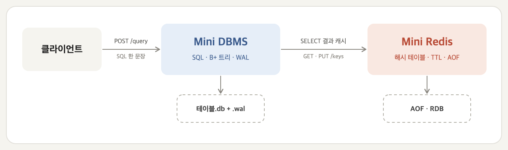
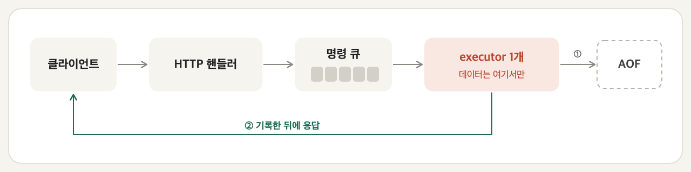
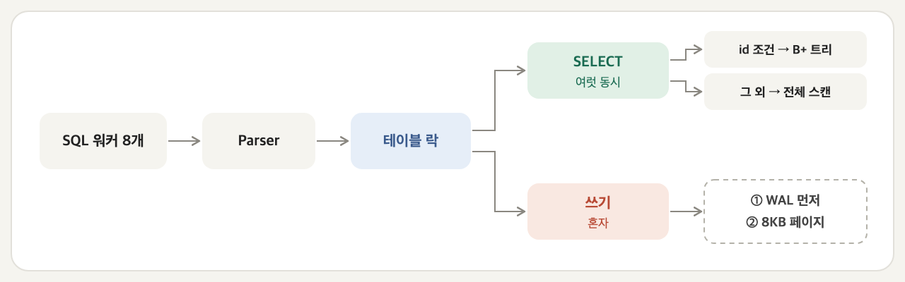
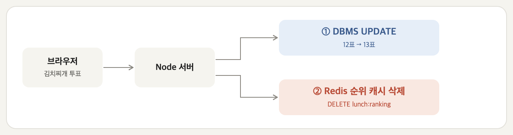
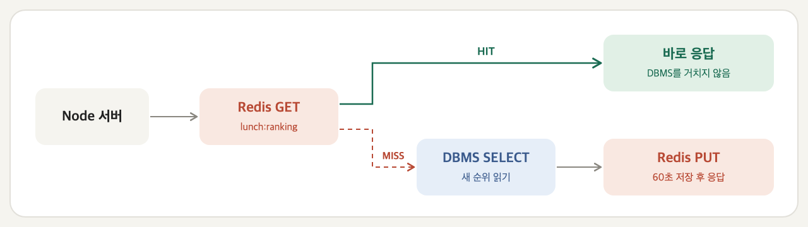
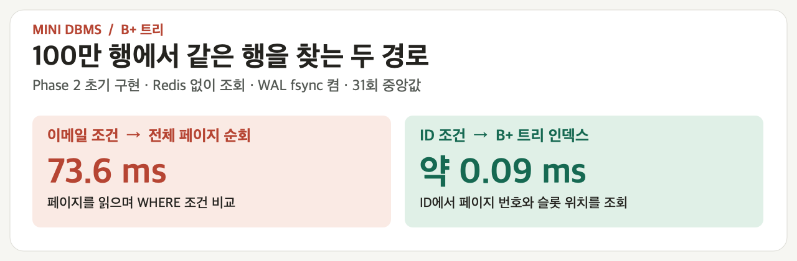
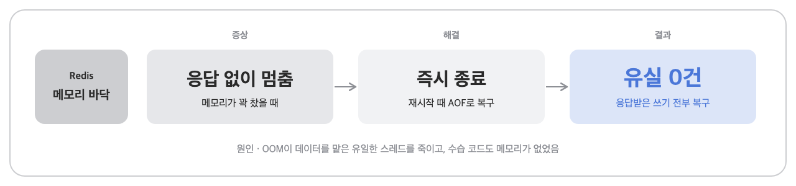
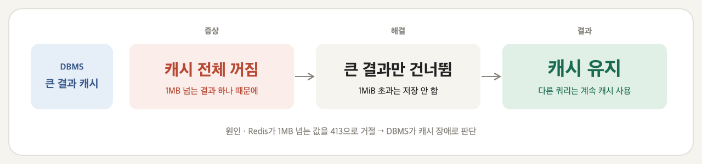
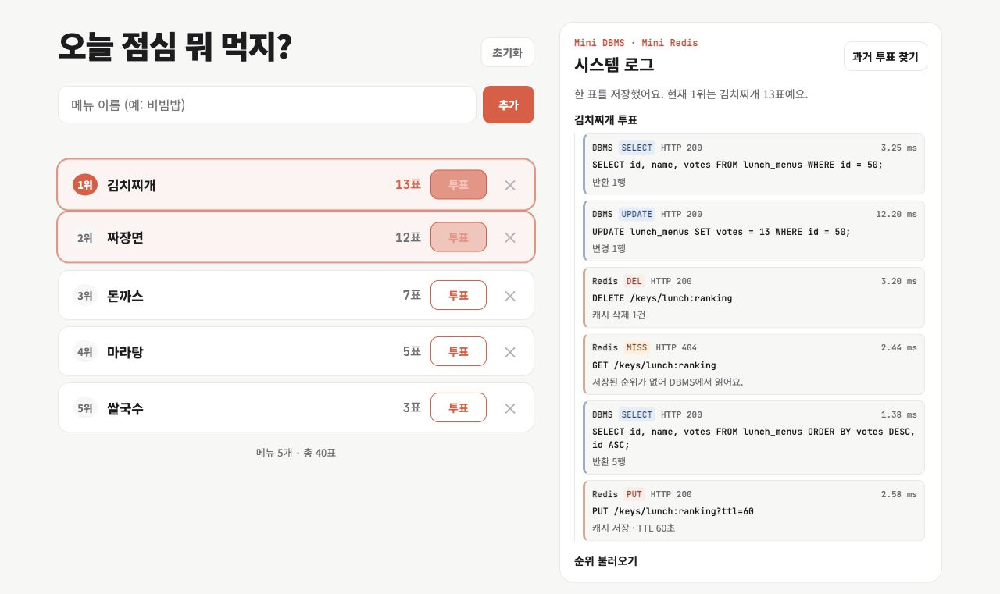

<div align="center">

# Mini DBMS + Mini Redis 발표

**Mini React 점심 투표에 직접 만든 Java DBMS와 Redis를 연결했습니다.**

Java 25 · 런타임 외부 라이브러리 0개 · 테스트 DBMS 246개 / Redis 57개 / 데모 7개 통과

</div>

한눈에 → Redis → DBMS → 투표 흐름 → 숫자로 보기 → 트러블슈팅 → 시연 (총 4분)

## 1. 프로젝트 한눈에



투표 데이터는 **Mini DBMS**에 SQL로 저장하고, 자주 읽는 순위는 **Mini Redis**에 캐시합니다.

## 2. Mini Redis 구현



| 주제 | 구현 |
|---|---|
| 해시 테이블 | 체이닝 + SipHash. 꽉 차면 2배로 키우고, 버킷을 명령마다 조금씩 옮깁니다(점진적 리해싱) |
| 동시성 | 데이터를 만지는 스레드를 **1개**로 고정해 락 없이 경쟁을 없앴습니다 |
| TTL | 조회할 때 지우고, 100ms마다 TTL 키 20개를 무작위로 검사해 남은 만료 키도 지웁니다 |
| 데이터 보존 | 응답 **전에** AOF에 기록합니다. `kill -9` 뒤에도 응답받은 쓰기는 복구됩니다 |

해시 테이블로 `SET`·`GET`·`DEL`과 TTL을 구현했습니다. 팀 버전은 전용 스레드에서 저장소를 다루고, 해시 테이블을 확장할 때는 버킷을 조금씩 옮깁니다.

## 3. Mini DBMS 구현



행은 **8KB 페이지**에 저장하고, 변경 사항을 WAL에 먼저 기록해 재시작할 때 복구합니다. 테이블별 읽기·쓰기 잠금으로 같은 테이블의 조회끼리 함께 실행할 수 있게 했습니다.

## 4. 둘이 만나는 곳: 투표 한 번

**투표하면: DB 먼저, 캐시는 그다음**



**순위를 읽을 때: 캐시 먼저**



DB를 **먼저** 고치고 캐시를 지웁니다. 순서를 바꾸면 그 사이에 옛 순위가 다시 캐시에 들어갈 수 있습니다.

## 5. 중점 개발: 숫자로 보기

### ① Redis 캐시: 약 26배 빨라짐


```
응답 p50   캐시 안 씀  ██████████████████████████  58.5 ms
           캐시 HIT    █                            2.24 ms   → 약 26배

처리량     캐시 안 씀  █                             845 req/s
           캐시 HIT    █████████████████████████  21,558 req/s → 약 25배

같은 키 동시 200건이 원본을 부른 횟수   200번 → 1번 (single-flight)
```

응답에 50ms 지연을 둔 상품 API에서 캐시 사용 여부를 바꿔 중앙값을 비교했습니다. 응답의 `X-Cache` 헤더로 실제 경로를 확인했습니다.

### ② B+ 트리: 100만 행에서 약 800배



```
한 행 찾기          전체 스캔   ████████████████████████  73.6 ms
                    B+ 트리     █                         0.09 ms   → 약 800배

ORDER BY id LIMIT 20  조기 종료 전  페이지 4,944개 읽음   129 ms
                      조기 종료 후  페이지     1개 읽음   0.17 ms
```

B+ 트리는 **ID를 페이지 번호와 슬롯 위치에 연결**합니다. 수치는 Phase 2 초기 구현에서 Redis 없이 100만 행 중 같은 행을 조회한 시간의 중앙값입니다.

### ③ 동시 실행과 커밋 안전성


B 요청은 A의 쓰기를 기다리지 않고 먼저 응답했습니다. A 조회는 커밋이 끝난 **새 값**만 봅니다.

```
100만 행 삽입   WAL fsync on   ███████  6.3 s   커밋마다 디스크 확정
                WAL fsync off  █        0.88 s  대신 정전 시 최근 커밋 유실 가능
```

## 6. 트러블슈팅






세부 내용: [Redis 트러블슈팅](mini-redis/트러블슈팅.md) · 메모리 문제는 `-XX:+ExitOnOutOfMemoryError`, 힙 32MB 재현 테스트로 확인했습니다.

## 7. 시연



| 시간 | 동작 | 화면에서 볼 것 |
|---|---|---|
| 0~20초 | 페이지 열기 | 첫 조회는 Redis MISS → DBMS SELECT → 캐시 저장, 새로고침하면 HIT |
| 20~40초 | 김치찌개 투표 | UPDATE → 캐시 키 삭제 → MISS → 재저장. 12표 → 13표로 1위 |
| 40~60초 | 과거 투표 찾기 | 100만 건에서 `id = 500000`(B+ 트리)과 `id = 500000 AND TRUE`(전체 스캔)의 시간 비교 |

실행 방법은 [lunch-demo/README.md](lunch-demo/README.md)에 있습니다.

## 부록: 협업과 머지


각자 만든 코드를 비교해 기능과 테스트를 함께 합쳤습니다.

자세한 내용: [Mini Redis](mini-redis/README.md) · [검증 결과](mini-redis/검증결과.md) · [트러블슈팅](mini-redis/트러블슈팅.md) · [Mini DBMS](mini-dbms/README.md)
