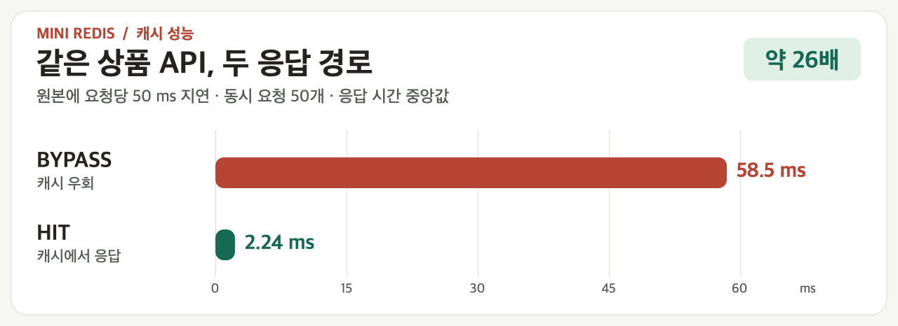
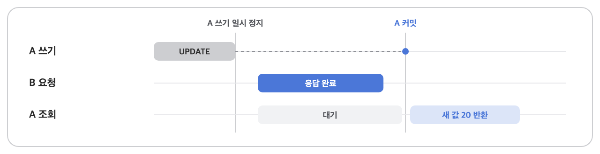

# Mini DBMS + Mini Redis 발표

**Mini React 점심 투표에 직접 만든 Java DBMS와 Redis를 연결했습니다.**

## 점심 투표 시연

## Mini Redis 구현과 성능

해시 테이블로 `SET`·`GET`·`DEL`과 TTL을 구현했습니다. 팀 버전은 전용 스레드에서 저장소를 다루고, 해시 테이블을 확장할 때는 버킷을 조금씩 옮깁니다.

응답에 50ms 지연을 둔 상품 API에서 캐시 사용 여부를 바꿔 중앙값을 비교했습니다. 응답의 `X-Cache` 헤더로 실제 경로를 확인했습니다.

## Mini DBMS와 HTTP 병렬 실행

행은 **8KB 페이지**에 저장하고, 변경 사항을 WAL에 먼저 기록해 재시작할 때 복구합니다. 테이블별 읽기·쓰기 잠금으로 같은 테이블의 조회끼리 함께 실행할 수 있게 했습니다.

## B+ 트리 조회 비교

B+ 트리는 **ID를 페이지 번호와 슬롯 위치에 연결**합니다. 수치는 Phase 2 초기 구현에서 Redis 없이 100만 행 중 같은 행을 조회한 시간의 중앙값입니다.

## 협업과 머지

각자 만든 코드를 비교해 기능과 테스트를 함께 합쳤습니다.
