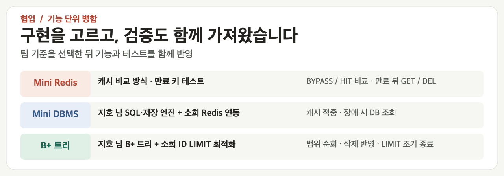

<div align="center">

# Mini DBMS + Mini Redis 발표

**Mini React 점심 투표에 직접 만든 Java DBMS와 Redis를 연결했습니다.**

[점심 투표 데모](lunch-demo/README.md) · [Mini DBMS](mini-dbms/README.md) · [Mini Redis](mini-redis/README.md)

</div>

## 0:00–0:20 · 내가 맡은 부분

Mini Redis를 직접 구현하고, 같은 API에서 캐시 사용 전후를 비교하는 방법을 만들었습니다. Mini DBMS에서는 Redis HTTP 연동, B+ 트리 실험과 단건 조회 개선, HTTP 서버와 테이블별 병렬 실행을 작업했습니다.

## 0:20–1:00 · 점심 투표 시연


| 화면에서 하는 일 | 시스템 로그 |
| --- | --- |
| **초기화 후 페이지 새로고침** | Redis `MISS` → DBMS `SELECT` → 캐시 저장 |
| **60초 안에 한 번 더 새로고침** | Redis `HIT` |
| **김치찌개에 한 표** | DBMS `UPDATE` → 이전 순위 캐시 삭제 → `MISS` → 새 순위 조회와 저장. 김치찌개가 **13표로 1위**에 올라갑니다. |

[데모 실행 및 데이터 준비](lunch-demo/README.md#발표-전-준비)

## 1:00–2:00 · Mini Redis 구현과 성능


해시 테이블로 `SET`·`GET`·`DEL`과 TTL을 구현했습니다. 팀 버전은 전용 스레드가 저장소를 다루고, 테이블 확장이 필요하면 버킷을 조금씩 옮깁니다.

상품 API에서 캐시 사용 여부만 바꿔 비교하고, 응답의 `X-Cache` 헤더로 실제 경로를 확인했습니다. [측정 조건과 결과](mini-redis/검증결과.md#3-성능-캐시-사용-전후)

## 2:00–3:00 · Mini DBMS와 HTTP 병렬 실행


SQL을 파싱하고 행을 **8KB 페이지**에 저장합니다. 변경 사항을 WAL에 먼저 기록해, 프로세스가 중간에 꺼져도 다시 열 때 복구할 수 있습니다.

HTTP SQL 워커가 테이블별 읽기·쓰기 잠금으로 요청을 처리합니다. 같은 테이블의 조회는 함께 실행할 수 있고, 쓰기 중 들어온 조회는 커밋된 값을 읽습니다. [HTTP 동시성 테스트](mini-dbms/src/test/java/minidb/api/QueryServerTest.java)

## 3:00–3:30 · B+ 트리 조회 비교


B+ 트리는 **ID를 페이지 번호와 슬롯 위치에 연결**합니다. 수치는 소희가 처음 구현한 Phase 2 버전 `4372f06`에서 잰 값입니다. 데모의 **과거 투표 찾기**에서는 현재 팀 버전으로 100만 건을 조회해 인덱스와 전체 스캔의 실제 시간을 비교할 수 있습니다. [벤치마크 재현 방법과 결과](mini-dbms/README.md#100만-행-벤치마크)

## 3:30–4:00 · 협업과 머지



각자 만든 결과를 비교한 뒤 **기능과 테스트를 함께 합쳤습니다.** 캐시가 만료된 뒤의 동작, 인덱스 범위 순회와 삭제 반영, `ORDER BY id LIMIT` 조기 종료를 검증했습니다. [Redis 병합 검증](mini-redis/검증결과.md) · [DBMS 인덱스 테스트](mini-dbms/src/test/java/minidb/engine/IndexIntegrationTest.java)

## 실행과 테스트

```bash
node lunch-demo/demo.mjs prepare
node lunch-demo/demo.mjs start
```

Node.js 22 이상과 JDK 25가 필요합니다. [로컬 점심 투표 데모](http://127.0.0.1:4173/)를 열면 됩니다. `prepare`는 데모용 데이터 100만 건을 미리 생성합니다. [실행 방법, API 및 데모 테스트](lunch-demo/README.md)

| 폴더 | 내용 | 테스트 |
| --- | --- | --- |
| [`mini-redis/`](mini-redis/) | Java 키·값 저장소와 HTTP API | `mvn -f mini-redis/pom.xml test` |
| [`mini-dbms/`](mini-dbms/) | SQL 엔진, 페이지·WAL, B+ 트리, HTTP 서버 | `mvn -f mini-dbms/pom.xml test` |
| [`lunch-demo/`](lunch-demo/) | 발표용 투표 앱과 두 서비스의 중계 서버 | 데모 실행 후 `node --test lunch-demo/demo.test.mjs` |
| [`scripts/`](scripts/) · [`study/`](study/) | 통합 실행 스크립트와 설계 자료 | |
