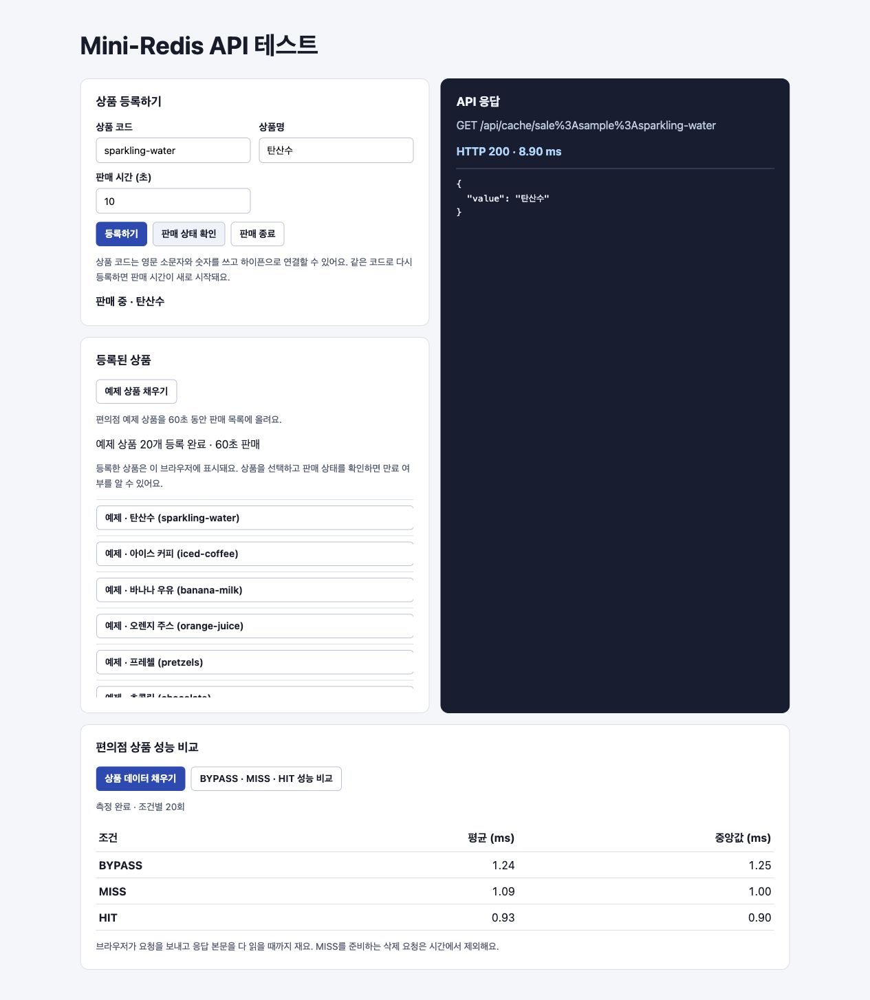

# Mini Redis

> 해시 테이블을 직접 구현하고, 외부 API에서 사용할 수 있는 키-값 저장소를 만드는 프로젝트입니다.

## 🎯 과제 목표

- 해시 테이블을 활용해 데이터를 저장하고, 조회하고, 삭제할 수 있는 키-값 저장소를 구현합니다.
- 외부 애플리케이션에서 이 저장소를 사용할 수 있도록 API를 제공합니다.
- 언어와 프레임워크는 자유롭게 선택합니다. AI 등의 도구를 활용해 동작하는 결과물을 만드는 것을 우선하되, 해시 테이블을 어떻게 설계하고 구현했는지, 주요 함수가 어떻게 동작하는지 설명할 수 있어야 합니다.

## 🧩 설계할 때 살펴볼 점

| 주제 | 설계 질문 |
| --- | --- |
| 동시성 | 여러 요청이 같은 키를 동시에 읽거나 수정할 때 데이터 일관성을 어떻게 지킬까? |
| 만료 시간(TTL) | 만료된 키를 조회하면 무엇을 반환하고, 만료된 데이터는 언제 정리할까? |
| 외부 API | 다른 애플리케이션에서 저장·조회·삭제를 쉽게 호출하려면 어떤 인터페이스가 좋을까? |
| 캐시 무효화 | 원본 데이터가 바뀌었을 때 사용자가 기존 캐시를 어떻게 무효화할 수 있을까? |
| 데이터 보존 (선택) | 서버가 비정상 종료된 뒤에도 데이터를 최대한 복구하려면 어떻게 보관해야 할까? |

## ✅ 검증 체크리스트

- [x] **단위 테스트:** 저장, 조회, 삭제가 정상적으로 동작하는지 확인합니다.
- [x] **기능 테스트:** 간단한 예제 API를 만들고, 응답을 Mini Redis에 저장한 뒤 다음 요청에서 재사용할 수 있는지 확인합니다.
- [x] **경계 사례:** 없는 키 조회·삭제, 같은 키 덮어쓰기, 만료된 키 조회, 같은 키에 대한 동시 요청을 확인합니다.
- [x] **성능 비교:** 같은 조건에서 예제 API의 캐시 사용 전후 응답 시간을 비교합니다.

## 개발 환경

JDK 21을 선택한 상태에서 Gradle Wrapper로 테스트 작업을 실행합니다.

```sh
./gradlew test
```

Java 소스는 `src/main/java`, JUnit 5 테스트는 `src/test/java`에 둡니다. Stage 1의 해시 테이블과 테스트는 각 경로의 `miniredis/storage` 패키지에 작성합니다.

## REST API 실행

JDK 21 환경에서 서버를 실행합니다. 기본 포트는 8080입니다.

```sh
./gradlew bootRun
```

| 요청 | 성공 응답 | 키가 없거나 만료된 경우 |
| --- | --- | --- |
| `PUT /api/cache/{key}` | `204 No Content` | 새 키를 생성합니다. |
| `GET /api/cache/{key}` | `200 OK`와 JSON 값 | `404 Not Found` |
| `DELETE /api/cache/{key}` | `204 No Content` | `404 Not Found` |

`PUT`은 JSON 문자열 `value`를 받습니다. 빈 문자열도 저장할 수 있습니다. `ttlSeconds`는 선택 항목이며, 지정할 때는 양의 정수를 사용합니다. 생략하거나 `null`을 전달하면 만료 시각 없이 저장하며 덮어쓰기 시 기존 TTL도 지웁니다. 잘못된 JSON, 공백뿐인 키, 유효하지 않은 값 또는 TTL에는 `400 Bad Request`와 `application/problem+json` 응답을 반환합니다.

```sh
curl -i -X PUT http://localhost:8080/api/cache/demo \
  -H 'Content-Type: application/json' -d '{"value":"hello"}'
curl -i http://localhost:8080/api/cache/demo
curl -i -X DELETE http://localhost:8080/api/cache/demo
curl -i http://localhost:8080/api/cache/demo

curl -i -X PUT http://localhost:8080/api/cache/temporary \
  -H 'Content-Type: application/json' -d '{"value":"short-lived","ttlSeconds":2}'
sleep 3
curl -i http://localhost:8080/api/cache/temporary
```

## 브라우저에서 테스트하기



`./gradlew bootRun`으로 서버를 실행하고 [API 테스트 페이지](http://localhost:8080/cache-test.html)를 엽니다. **상품 등록하기**에서 상품 코드 `cola`, 상품명 `콜라`, 판매 시간 10초를 입력해 등록하면 `sale:cola` 키에 상품명 문자열 하나가 저장됩니다.

등록이 성공하면 브라우저에 상품 코드와 상품명을 저장해 목록에 표시합니다. 새로고침하면 브라우저에 저장된 목록을 불러옵니다. TTL이 지난 뒤 **판매 상태 확인**을 누르면 서버가 404를 반환하고 해당 상품이 목록에서 빠집니다. 같은 상품 코드로 다시 등록하면 판매 시간이 새로 시작되며, **판매 종료**로 바로 삭제할 수 있습니다.

**예제 상품 채우기**를 누르면 편의점 예제 20개가 `sale:sample:{code}`에 60초 동안 등록됩니다. 목록에서 **예제**로 표시되며, 같은 코드로 직접 등록한 상품과 각각 조회하거나 판매 종료할 수 있습니다.

**상품 데이터 채우기**를 누르면 편의점 예제 상품 20개의 JSON 응답을 `PUT /api/cache/{key}`로 Mini-Redis에 저장합니다. 채우기가 끝나면 **BYPASS · MISS · HIT 성능 비교**를 눌러 같은 20개 상품의 조건별 평균과 중앙값을 볼 수 있습니다. 브라우저에서 응답 본문을 다 읽을 때까지 시간을 재고, MISS를 준비하는 삭제는 측정 시간에서 제외합니다.

## 편의점 상품 API 캐싱 예제

`GET /api/store/products`는 예제 카탈로그를 반환하고, `GET /api/store/products/{code}`는 개별 상품 JSON을 반환합니다. 개별 응답은 `store:product:{code}`에 30초간 캐싱하며, 직접 등록한 상품에는 `sale:{code}` 키를 사용합니다. 응답의 `X-Cache` 헤더에서 처리 경로를 확인할 수 있습니다.

- `MISS`는 키가 없거나 만료됐을 때입니다. `demo/store-products.json`에서 상품을 찾아 응답 본문을 Mini-Redis에 저장합니다.
- `HIT`은 유효한 캐시가 있을 때입니다. 저장된 JSON을 그대로 반환합니다.
- `BYPASS`는 `?cached=false`를 붙였을 때입니다. 캐시를 읽거나 갱신하지 않고 같은 원본을 읽습니다.

```sh
curl -i 'http://localhost:8080/api/store/products/cola?cached=false'
curl -i http://localhost:8080/api/store/products/cola
curl -i http://localhost:8080/api/store/products/cola
curl -i -X DELETE http://localhost:8080/api/cache/store:product:cola
curl -i http://localhost:8080/api/store/products/cola
```

비어 있는 서버에서 실행하면 `BYPASS → MISS → HIT → 204 → MISS` 순서로 확인할 수 있습니다. 마지막 `MISS`에서 캐시가 다시 채워지고 30초가 지나면 다음 조회는 `MISS`가 됩니다.

### 저장소 구조

`CacheController`는 HTTP 요청을 검증하고 `MiniRedisService`에 전달합니다. `ConvenienceStoreController`는 같은 서비스를 사용해 상품 응답을 저장하고 다시 읽습니다. 서비스는 값과 만료 시각을 함께 저장하며, 조회 시 만료된 엔트리를 제거합니다. 서비스 인스턴스의 CAS 락 하나가 각 명령과 조회 중 만료 삭제를 보호합니다.

`HashTable`은 문자열 해시를 버킷 인덱스로 바꾸고, 같은 버킷의 엔트리를 연결 리스트로 관리합니다. `put`은 같은 키를 덮어쓰거나 새 엔트리를 연결합니다. `get`은 키를 찾아 값을 반환하고, `remove`는 버킷의 시작점 또는 직전 엔트리의 링크를 갱신합니다. 버킷 수가 고정돼 있어 한 버킷에 키가 몰리면 탐색 비용이 커집니다.

### 성능 비교

로컬에서 서버를 띄운 뒤 Python 3으로 예제 상품 `cola`를 반복 측정합니다. 스크립트는 `store:product:cola`를 삭제해 MISS를 준비합니다.

```sh
python3 scripts/benchmark_cache.py --port 8080 --warmup 150 --requests 300 --rounds 3
```

Apple M4, macOS 26.6.2, Temurin 21.0.13, Spring Boot 4.1.2, Python 3.14.7 환경에서 실행 JAR과 클라이언트를 같은 컴퓨터에서 실행했습니다. HTTP 연결 하나를 재사용하고, 조건별 150건으로 워밍업한 뒤 라운드마다 조건별 300건을 측정했습니다. 세 조건의 요청 순서를 번갈아 바꾸고, 같은 응답 본문과 예상 `X-Cache` 값을 매번 확인했습니다. 시간에는 HTTP 요청과 응답 본문 읽기가 포함됩니다. `MISS`를 만들기 위한 사전 삭제는 측정 구간 밖에서 실행했습니다.

| 라운드 | 조건 | 요청 수 | 평균(ms) | 중앙값(ms) |
| --- | --- | ---: | ---: | ---: |
| 1 | BYPASS | 300 | 0.2869 | 0.2401 |
| 1 | MISS | 300 | 0.2864 | 0.2384 |
| 1 | HIT | 300 | 0.2330 | 0.1946 |
| 2 | BYPASS | 300 | 0.1355 | 0.1183 |
| 2 | MISS | 300 | 0.1350 | 0.1170 |
| 2 | HIT | 300 | 0.1277 | 0.0989 |
| 3 | BYPASS | 300 | 0.1108 | 0.1086 |
| 3 | MISS | 300 | 0.1113 | 0.1046 |
| 3 | HIT | 300 | 0.0970 | 0.0911 |
| 전체 | BYPASS | 900 | 0.1777 | 0.1227 |
| 전체 | MISS | 900 | 0.1776 | 0.1244 |
| 전체 | HIT | 900 | 0.1526 | 0.1047 |

이 실행에서 `HIT`은 `BYPASS`보다 평균 약 14%, 중앙값 약 15% 짧았습니다. `MISS`는 원본 읽기와 캐시 저장을 수행하며, 이번 실행의 평균은 `BYPASS`와 비슷했습니다. 원본이 작은 로컬 JSON이라 조건 간 차이보다 라운드 사이 변동 폭이 컸습니다. 이 결과는 자체 Mini-Redis와 단일 로컬 클라이언트에서 측정한 응답 시간입니다. 동시 `MISS`가 발생하면 각 요청이 원본을 읽을 수 있습니다.

### 영속화 검토

현재 데이터는 프로세스 메모리에 있어 재시작하면 사라집니다. Snapshot은 일정 시점의 키·값·만료 시각을 저장하므로 복구가 단순하지만 마지막 저장 이후 변경을 잃을 수 있습니다. AOF는 `SET`과 `DEL`을 기록해 다시 실행하는 방식입니다. 디스크 동기화 주기에 따라 유실 범위와 쓰기 비용이 달라집니다. 두 방식 모두 만료 시각을 절대 시각으로 저장하고, 복구 시 이미 만료된 키를 제외해야 합니다.
