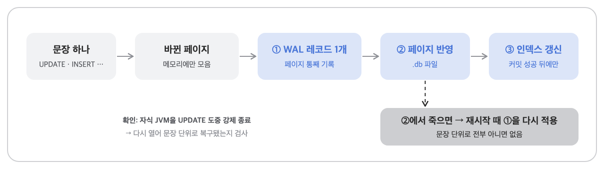
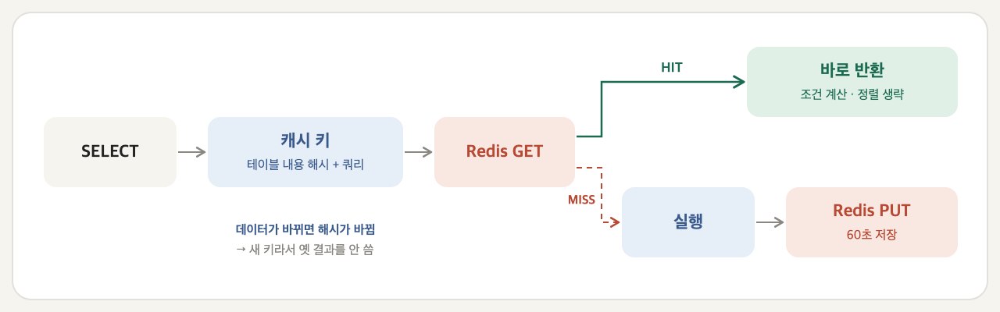
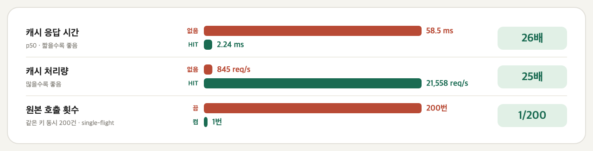
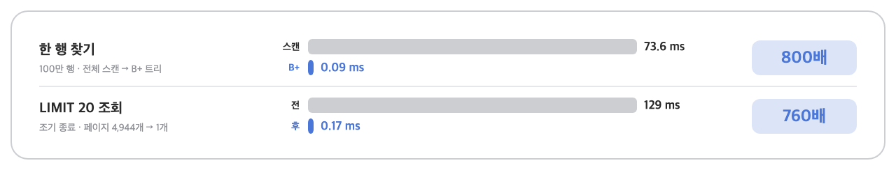
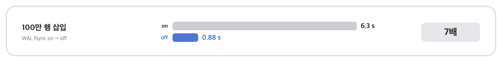
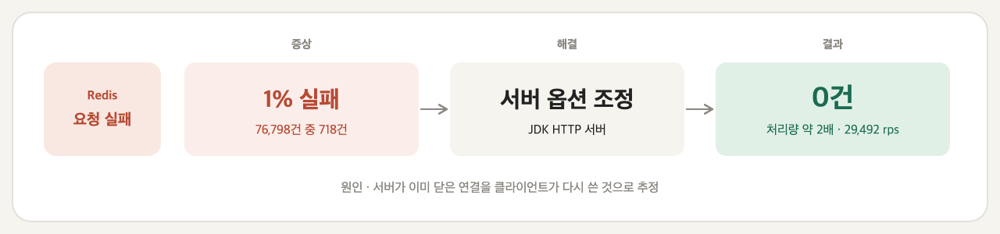
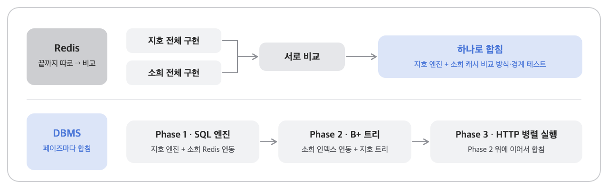

# Mini DBMS + Mini Redis 발표

**Java로 Redis와 DBMS를 직접 만들고, DBMS의 SELECT 결과를 Redis에 캐시했습니다.**

Java 25 · 런타임 외부 라이브러리 0개 · 테스트 DBMS 246개 / Redis 57개 통과

한눈에 → Redis → DBMS → DBMS와 Redis 연결 → 숫자로 보기 → 트러블슈팅 → 협업 방식

## 1. 프로젝트 한눈에

두 서버는 서로의 코드를 모르고 HTTP로만 연결됩니다.

## 2. Mini Redis 구현

해시 테이블·TTL·AOF는 Redis와 같은 방식이고, 아래는 우리가 따로 설계한 부분입니다.

- **묶어서 기록한 뒤 응답**: 큐에서 최대 128개를 꺼내 실행하고 AOF에 **한 번에** 쓴 다음 응답합니다. 응답을 받았다면 이미 기록된 상태입니다.
- **fork 없는 Java에서 백그라운드 저장**: BGSAVE와 AOF 압축을 틱마다 조금씩 순회합니다. 그동안의 쓰기는 새 incr 파일로 보내서 결과가 어긋나지 않습니다.
- **INCR은 결과값 SET으로 기록**: 복구할 때 다시 실행해도 두 번 오르지 않습니다.
- **브라우저 요청 차단**: `Origin` 헤더가 붙은 요청은 403으로 거절합니다.

## 3. Mini DBMS 구현

**문장 하나 = 커밋 하나**

- **전부 아니면 없음**: 바꿀 페이지를 메모리에 모아 WAL 레코드 하나로 기록합니다. 자식 JVM을 UPDATE 도중 강제 종료하는 크래시 테스트로 확인했습니다.
- **인덱스는 메모리 B+ 트리**: 테이블을 열 때 다시 만들고, 커밋이 성공한 뒤에만 갱신합니다. `ORDER BY id LIMIT`은 인덱스를 따라가다 조기 종료합니다.
- **동시성 경계**: 테이블별 읽기·쓰기 락에 더해, 데이터 폴더 락으로 다른 프로세스의 동시 열기를 막습니다. 워커 8개와 대기 64개를 넘는 요청은 기다리지 않고 바로 503으로 응답합니다.

## 4. DBMS와 Redis 연결: SELECT 캐시

- 키에 **테이블 내용 해시**를 넣어서, 데이터가 바뀌면 캐시를 지우지 않아도 옛 결과를 쓰지 않습니다. 옛 키는 TTL로 사라집니다.
- Redis가 응답하지 않으면 캐시를 끄고 DB에서 읽습니다. 1MiB가 넘는 결과는 저장하지 않습니다.
- 대가: 해시를 계산하려고 HIT여도 테이블 페이지는 모두 읽습니다. 정확성을 먼저 택했습니다.

## 5. 중점 개발: 숫자로 보기

### ① Redis 캐시 효과

응답에 50ms 지연을 둔 상품 API에서 캐시 사용 여부만 바꿔 중앙값을 비교했습니다. 응답의 `X-Cache` 헤더로 실제 경로를 확인했습니다.

### ② DBMS 조회 속도: B+ 트리

B+ 트리는 ID를 페이지 번호와 슬롯 위치에 연결해서, 읽을 페이지 수 자체를 줄입니다. 수치는 Redis 없이 100만 행에서 잰 중앙값입니다.

### ③ 쓰기 속도와 안전성: fsync

끄면 7배 빠르지만, 정전·OS 크래시 때 최근 커밋을 잃을 수 있습니다. 그래서 **기본값은 on**입니다.

### ④ 동시 실행

B 요청은 A의 쓰기를 기다리지 않고 먼저 응답했습니다. A 조회는 커밋이 끝난 **새 값**만 봅니다.

## 6. 트러블슈팅

세부 내용: [Redis 트러블슈팅](mini-redis/트러블슈팅.md) · 메모리 문제는 `-XX:+ExitOnOutOfMemoryError`, 힙 32MB 재현 테스트로 확인했습니다.

## 7. 협업 방식

- **Redis**: 둘 다 처음부터 끝까지 구현한 뒤 비교했습니다. 지호 엔진을 기준으로 소희 구현의 캐시 비교 방식(`BYPASS`·`X-Cache`)과 경계 테스트를 가져왔습니다.
- **DBMS**: 규모가 커서 페이즈마다 비교하고 합친 뒤, 합친 결과 위에서 다음 페이즈를 시작했습니다.

자세한 내용: [Mini Redis](mini-redis/README.md) · [검증 결과](mini-redis/검증결과.md) · [트러블슈팅](mini-redis/트러블슈팅.md) · [Mini DBMS](mini-dbms/README.md)
