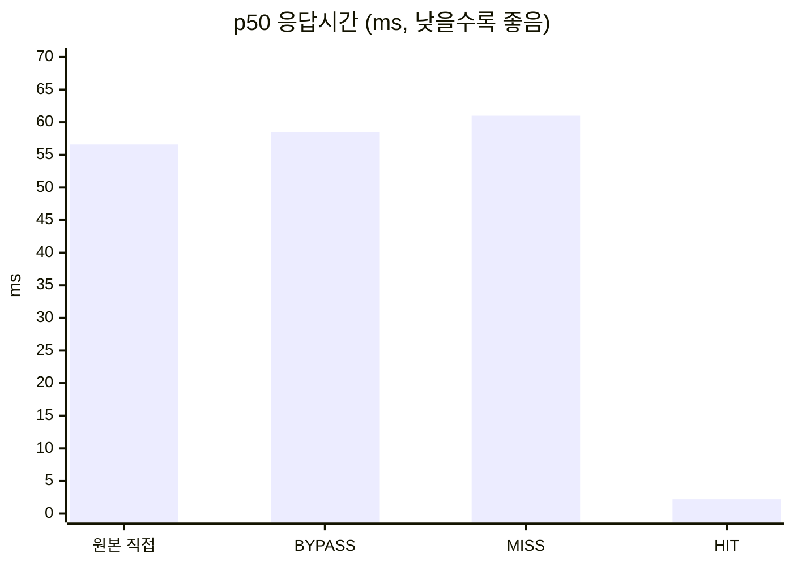

# 검증 결과 (team-merge)

지호 구현을 기준으로 소희 구현의 좋은 점을 옮긴 뒤 검증했다. 2026-11-16, Apple Silicon 8코어, JDK 25.0.5.

## 1. 소희 구현에서 가져온 것

| 항목 | 위치 | 이유 |
|---|---|---|
| 캐시 우회 `?cached=false` + `X-Cache: HIT/MISS/BYPASS` 헤더 | `CacheApiMain` | 캐시 유무만 다르게 하고 경로(손님 → 상품 API 서버)는 같게 재기 위해 |
| 측정 응답 검증 `--expect-cache`, 키 뒤 붙임 `--suffix` | `BenchMain` | 정말 HIT/MISS로 처리됐는지 요청마다 확인 |
| 만료 키 DEL은 0, 만료 뒤 SET은 새 값 유지 | `StoreTest` | 경계 사례 (코드는 이미 그렇게 동작, 테스트만 추가) |
| 래치로 동시에 출발시키는 동시 DEL 테스트 | `ConcurrencyAndProcessTest` | 운에 기대지 않고 "성공은 정확히 1번"을 확인 |

가져오지 않은 것: 고정 크기 해시 테이블과 CAS 락(지호 쪽 크기 조정 + 스레드 1개가 더 나음), Spring JSON API(외부 형식이 바뀌면 호출부 전부 수정), 브라우저 테스트 페이지(Origin 헤더 403 정책과 충돌), 벽시계(단조 시계가 시간 변경에 안전).

## 2. 테스트

```bash
JAVA_HOME=~/tools/jdk-25.0.5+8/Contents/Home ~/tools/apache-maven-3.9.16/bin/mvn test
```

**57개 모두 통과 (실패 0, 오류 0).** 새로 추가한 7개는 ★로 표시했다.

| 과제 체크리스트 | 테스트 | 결과 |
|---|---|---|
| 단위: 저장·조회·삭제 | `StoreTest#setGetDel`, `HashTableTest#setGetDelete`, `HttpApiTest#endpoints` | 통과 |
| 경계: 없는 키 조회·삭제 | `StoreTest#setGetDel` (두 번째 DEL = 0, GET = null) | 통과 |
| 경계: 같은 키 덮어쓰기 | `StoreTest#putWithoutTtlRemovesTtl` | 통과 |
| 경계: 만료된 키 | `StoreTest#ttlJustBeforeAndAfter`, ★`delOnExpiredKeyReturnsZero`, ★`setAfterExpiryKeepsFreshValue` | 통과 |
| TTL: 조회하지 않은 만료 키 정리 | `StoreTest#periodicCleanupRemovesExpiredWithoutLookup` | 통과 |
| 경계: 같은 키 동시 요청 | `ConcurrencyAndProcessTest#concurrentIncrIsExact` (10만 번 INCR), ★`concurrentDelSucceedsExactlyOnce` | 통과 |
| 기능: 예제 API 응답 재사용 | ★`CacheApiTest#bypassThenMissThenHit` (BYPASS → MISS → HIT, 원본 호출 2번) | 통과 |
| 캐시 무효화 | ★`CacheApiTest#writeInvalidatesCache` (원본 PUT 뒤 다음 조회가 MISS, 새 값) | 통과 |
| 없는 상품 캐시 | ★`CacheApiTest#missingProductIsCachedAsNone` (두 번째 404는 HIT) | 통과 |
| 동시 MISS | ★`CacheApiTest#concurrentMissCallsOriginOnce` (50개 동시 요청, 원본 1번) | 통과 |
| 해시 테이블 | `HashTableTest` 11개 (확장·축소·리해싱 중 일치·한글 키) | 통과 |
| 데이터 보존 (선택) | `PersistenceTest` 8개, `kill -9` 뒤 재시작, 손상 감지 | 통과 |
| 입력·보안 | `HttpApiTest#invalidInputs`, `bodySizeLimit`, `originAndAuth` | 통과 |

- **테스트가 실제로 잡아내는지 확인**: BYPASS가 캐시에 쓰도록 일부러 고쳤더니 `bypassThenMissThenHit`가 실패했다(`CacheApiTest.java:80`). 원래대로 되돌린 뒤 통과.
- **타이밍에 기대는 테스트 반복**: `concurrentMissCallsOriginOnce`는 원본이 50ms 걸리는 동안 50개가 모두 도착해야 통과한다. 따로 5번 돌려 5번 모두 통과했다.
- **"만료 GET 도중 SET" 경쟁**(소희 테스트)은 지호 구조에서 일어날 수 없다. 데이터를 만지는 스레드가 하나뿐이고, 다른 스레드의 호출은 `StoreTest#otherThreadIsRejected`가 거부함을 확인한다. 그래서 순서를 정해 실행하는 테스트로 대신했다.

## 3. 성능: 캐시 사용 전후

원본은 응답마다 50ms 지연(느린 DB 흉내). 모든 조건은 같은 설정이다: 동시 50, 워밍업 5초, 측정 10초, 오류 0.
라운드마다 조건 순서를 바꿔 3라운드를 쟀다(순서 교차, 출처: 소희 구현). 1: A·B·M·H, 2: H·M·B·A, 3: B·H·A·M. 표의 값은 조건별 3회 값의 중앙값이다.



```
원본 직접  56.6ms  ████████████████████████████
BYPASS     58.5ms  █████████████████████████████
MISS       61.0ms  ██████████████████████████████
HIT         2.2ms  █
```

| 조건 | 경로 | p50 | p95 | 처리량 (req/s) |
|---|---|---:|---:|---:|
| 원본 직접 | 손님 → 원본 | 56.6ms | 60.1ms | 880 |
| BYPASS (캐시 안 씀) | 손님 → 상품 API → 원본 | 58.5ms | 64.6ms | 845 |
| MISS (캐시 비어 있음) | 손님 → 상품 API → 캐시 → 원본 → 캐시 저장 | 61.0ms | 70.0ms | 800 |
| HIT (캐시 있음) | 손님 → 상품 API → 캐시 | **2.24ms** | **3.45ms** | **21,558** |

라운드별 p50 (ms): A 56.2 / 56.6 / 56.6, BYPASS 57.7 / 58.5 / 58.8, MISS 60.3 / 61.6 / 61.0, HIT 2.23 / 2.24 / 2.24. 순서를 바꿔도 대소 관계는 같았다.

**읽는 법**
- **캐시 효과 (BYPASS → HIT)**: p50이 58.5ms에서 2.24ms로 약 26배 빨라졌고, 처리량은 약 25배 늘었다.
- **BYPASS − 원본 직접 = +1.9ms**: 상품 API 서버를 한 번 거치는 비용이다. BYPASS를 넣은 이유가 이 차이를 비교에서 빼기 위해서다.
- **MISS − BYPASS = +2.5ms**: 캐시를 조회하고 저장하는 추가 비용이다. 첫 요청은 캐시가 없을 때보다 조금 느리다.

### 같은 키에 동시 요청이 몰릴 때 (single-flight)

비어 있는 키 하나에 동시 200개 요청, 2초 측정, 2회.

| single-flight | 원본 호출 수 |
|---|---:|
| 끔 | 200, 200 |
| 켬 | **1, 1** |

```
끔  200회  ████████████████████
켬    1회  ▏
```

```bash
$JAVA_HOME/bin/java -cp target/classes example.bench.BenchMain --url http://127.0.0.1:8082/products/ --keys 100 --suffix '?cached=false' --expect-cache BYPASS --concurrency 50 --warmup 5 --duration 10 --repeat 1 --cache-stats http://127.0.0.1:8082/stats --origin-stats http://127.0.0.1:8081/stats
```

조건마다 `--url`, `--suffix`, `--expect-cache`, `--miss-ratio 1`(MISS)만 바꿨다. single-flight 측정은 `--concurrency 200 --warmup 0 --duration 2 --same-key <새 키>`이고, 끈 경우는 `CacheApiMain --singleflight false`로 다시 띄웠다. 소희 구현의 측정값(약 0.1ms)과는 직접 비교하지 않는다. 원본이 로컬 JSON이고 같은 프로세스 안에서 호출하는 구조라, 측정 조건이 다르다.

> Mermaid 차트가 GitHub에서 그려지는지는 아직 확인하지 않았다. 그래서 텍스트 막대를 함께 둔다.
